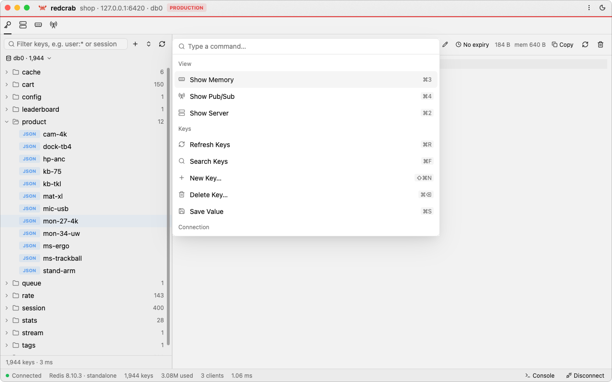
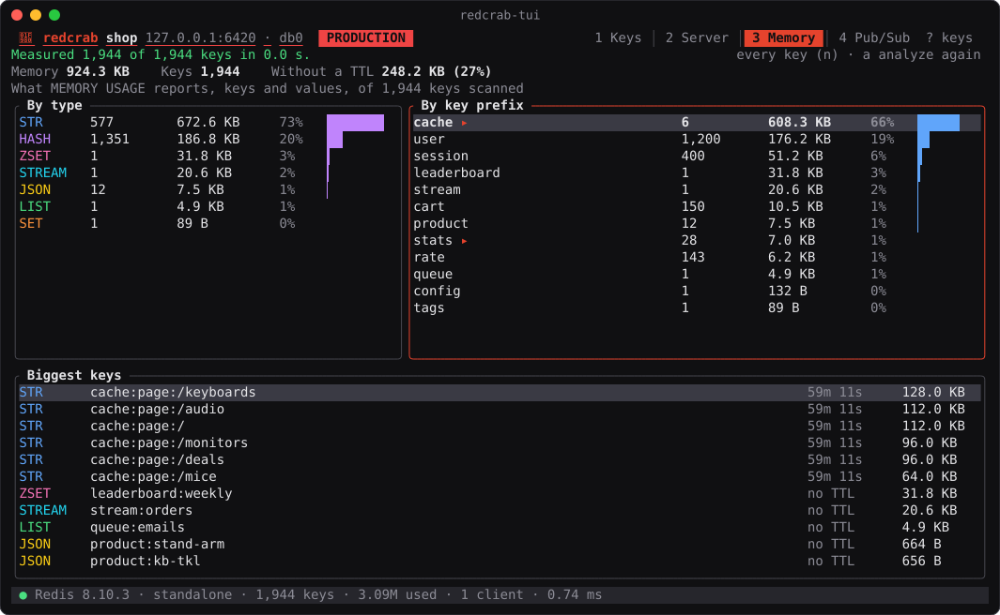

# Using redcrab

The desktop app, view by view, and the terminal app. How to reach a server is in
[Connections](connections.md); what redcrab keeps on disk is in [Security](security.md).

- [Keys and values](#keys-and-values)
- [Console](#console)
- [Server](#server)
- [Memory](#memory)
- [Pub/Sub and MONITOR](#pubsub-and-monitor)
- [Command palette and settings](#command-palette-and-settings)
- [Updates](#updates)
- [Terminal app](#terminal-app)
- [How it stays fast](#how-it-stays-fast)

## Keys and values

<p align="center">
  <picture>
    <source media="(prefers-color-scheme: dark)" srcset="images/keys-dark.png">
    
  </picture>
</p>

The key tree splits names on the connection's separator (`:` unless set otherwise) into
folders, with the number of keys in each. <kbd>⌘F</kbd> filters it, by a pattern
(`user:*`) or any text; a folder's menu, or **Delete matching…** under a filter, deletes
every key it holds after showing the exact pattern and count.

Values of every type can be edited: strings and JSON documents as text, collection rows
in a detail pane, rows added and deleted, keys created, renamed and given a TTL. Values
show as text, JSON, a hex dump, or decoded from Base64, MessagePack or gzip, and are
saved back in the same format. Bytes that are not text are edited the way `redis-cli`
writes them (`"\xff\x00"`).

Every change is one step on one key (mostly a Lua script), so it is atomic and checks what
it relies on: a key deleted or replaced since it was loaded is never recreated or
overwritten, a list element is only changed while it still holds what was loaded, a new key
never replaces an existing one. A read-only connection refuses every change in core, not
just in the UI. Users whose ACL denies scripts (`-@scripting`) can still save strings,
create string keys, change TTLs and rename keys; editing collections and creating keys of
other types needs `EVAL`, and after the first refusal the value panel stops offering it.

## Console

<p align="center">
  <picture>
    <source media="(prefers-color-scheme: dark)" srcset="images/console-dark.png">
    
  </picture>
</p>

<kbd>⌘J</kbd> opens a console with a connection of its own, so `SELECT` and `MULTI` stay
in it. <kbd>↑</kbd> <kbd>↓</kbd> walk the history, <kbd>Tab</kbd> completes command
names, subcommands and the options a command takes at the cursor (again to cycle), the
rest of the command's syntax shows greyed out as you type, <kbd>Esc</kbd> closes the
suggestions or stops a running command, and <kbd>⌘K</kbd> clears the log.

Shortcuts use <kbd>⌘</kbd> on macOS and <kbd>Ctrl</kbd> on Linux and Windows
(<kbd>Ctrl</kbd>+<kbd>J</kbd>, <kbd>Ctrl</kbd>+<kbd>S</kbd>, ...).

## Server

<p align="center">
  <picture>
    <source media="(prefers-color-scheme: dark)" srcset="images/server-dark.png">
    
  </picture>
</p>

The **Server** tab (<kbd>⌘2</kbd>; <kbd>⌘1</kbd> goes back to the keys) shows what the server
says about itself, read every two seconds while it is open and never while it is not:

- **Overview:** operations per second, memory (with its peak, RSS, fragmentation and
  `maxmemory`), clients and the hit rate, each with its last two minutes charted; keys
  per database, the server and its uptime, persistence and replication.
- **Slow Log:** the slowest commands as typed, how long they took, when and from which
  client, and how the log is set up; **Reset…** empties it.
- **Clients:** every connection, filtered by address, name, user or command, with
  redcrab's own marked; **Kill…** disconnects one.
- **INFO:** every field, filtered.

On a cluster it looks at one primary at a time, picked at the top right. Reset and Kill
are refused on a read-only connection, and they ask first. A user whose ACL lacks
`INFO`, `SLOWLOG` or `CLIENT` sees why instead of the figures.

## Memory

<p align="center">
  <picture>
    <source media="(prefers-color-scheme: dark)" srcset="images/memory-dark.png">
    
  </picture>
</p>

The **Memory** tab (<kbd>⌘3</kbd>) finds what takes the memory: it walks the keys with
`SCAN` and measures each with `MEMORY USAGE` (`TYPE` and `PTTL` in the same round trip),
when you click **Analyze**, never on its own. It shows

- the total, the keys, and how much of the memory is in keys without a TTL;
- the memory per type, and per key prefix, split on the connection's separator, three
  levels deep: click a prefix to look into it;
- the 100 biggest keys: click one to open it in the keys view.

On a large or busy server, measure **1 key in 10** or **1 in 100**: the totals are then
estimates (marked ≈), the measured figures times the sample. A cluster is walked
primary by primary. It only reads, so it works on a read-only connection; the user needs
the `MEMORY` command.

## Pub/Sub and MONITOR

<p align="center">
  <picture>
    <source media="(prefers-color-scheme: dark)" srcset="images/pubsub-dark.png">
    
  </picture>
</p>

The **Pub/Sub** tab (<kbd>⌘4</kbd>) subscribes to channels, and to patterns when the name
has `*`, `?` or `[` (PSUBSCRIBE), on a connection of its own, and lists the messages as
they come, with their local time, newest first and filtered by channel or payload. It
lists the channels that have subscribers (`PUBSUB CHANNELS`, one click subscribes), and
publishes a message, which a read-only connection does not: subscribers act on what
they receive.

**Monitor** shows every command the server runs (`MONITOR`), on a cluster primary of
your choice. It slows a busy server down, by as much as half, so it runs only when
started and stops when you leave the tab. Both keep the newest 10,000 entries.

## Command palette and settings

<p align="center">
  <picture>
    <source media="(prefers-color-scheme: dark)" srcset="images/palette-dark.png">
    
  </picture>
</p>

<kbd>⌘K</kbd> opens the command palette: everything the window can do, with its
shortcut, found by typing a few letters. Refresh or search the keys, add or delete one,
open the console, switch to another database, disconnect, connect to a saved connection
(in a new window when one is open), change the theme, look for updates. In the console
<kbd>⌘K</kbd> clears the log, as in a terminal; <kbd>⇧⌘P</kbd> opens the palette from
anywhere.

<kbd>⌘,</kbd> opens the settings, which are saved as `settings.json` next to the saved
connections:

| Setting | Default | |
| --- | --- | --- |
| Theme | System | System follows the light or dark mode of the OS as it changes. The title bar's sun/moon picks one and keeps it. |
| Text size | Medium | Small, Medium or Large; the whole interface scales with it. |
| Load at most | 2,000,000 keys | Where a scan of the key list stops (about 60 bytes per key). A filter finds keys past it. |
| Keys per SCAN | 2,000 | The `COUNT` of each `SCAN`: smaller keeps each round trip short on a busy server, larger loads faster. |
| Check for updates automatically | On | Packaged builds only. |

## Updates

From 0.2.0 on, redcrab looks for a new release when it starts and once a day after,
and asks before it installs one: **Install and Restart**, **Later**, or **Skip This
Version**. The title bar's ⋮ menu (or the command palette) checks right away, and
**Settings** turns the daily check off; so does `REDCRAB_NO_UPDATE_CHECK=1`. Only the GitHub API is asked, and
nothing about you or your connections is sent.

An update installs only if `SHA256SUMS` carries the release key's Ed25519 signature
and the download matches it, so a file swapped on GitHub or on the way is refused.
The new version replaces the app where it is: `redcrab.app` (which needs a folder you
can write to, such as Applications, not the disk image), the `.deb` (through
`pkexec`, which asks for an administrator's password) or the unpacked tarball or
zip. When it cannot, the dialog links to the download instead. Builds from source
never look for updates. The Homebrew cask updates itself the same way, so
`brew upgrade` leaves it alone; Homebrew's `redcrab-tui` updates with `brew upgrade`.

## Terminal app

<p align="center">
  
</p>

`redcrab-tui` is redcrab in a terminal, for a server reached over SSH or a machine
without a GPU: the same saved connections and passwords, the key tree, values of every
type, editing and the console, the server tools, the memory analysis and Pub/Sub, on the
same core.

```sh
redcrab-tui                          # pick a saved connection
redcrab-tui orders                   # connect to the saved connection "orders"
redcrab-tui redis://:pw@10.0.0.5:6379/2
```

The keys are vim's or the arrows: <kbd>j</kbd> <kbd>k</kbd> to move, <kbd>l</kbd>
<kbd>h</kbd> to open and close folders, <kbd>/</kbd> to filter, <kbd>Tab</kbd> to the
next pane, <kbd>:</kbd> for the console, <kbd>?</kbd> for all of them. In the value,
<kbd>f</kbd> cycles the format (Text, JSON, Hex, Base64, MessagePack, gzip),
<kbd>e</kbd> edits it in `$VISUAL` or `$EDITOR`, <kbd>t</kbd> sets the TTL,
<kbd>R</kbd> renames the key, <kbd>a</kbd> adds a row and <kbd>x</kbd> deletes the rows
picked with <kbd>Space</kbd>. <kbd>n</kbd> makes a key, <kbd>D</kbd> deletes one, and
<kbd>b</kbd> switches the database. A read-only connection stays read-only here too.

<kbd>1</kbd> to <kbd>4</kbd> switch between the keys, the server tools, the memory
analysis and Pub/Sub, as on the desktop. The server tools page with <kbd>[</kbd>
<kbd>]</kbd> through the overview (figures with two minutes of trends), the slow log,
the clients (<kbd>x</kbd> kills one) and INFO, and with <kbd>&lt;</kbd> <kbd>&gt;</kbd>
through the primaries of a cluster. The memory analysis runs on <kbd>a</kbd>, on every
key or a sample (<kbd>n</kbd>); <kbd>Enter</kbd> looks into a prefix, or shows a big key
in the keys. In Pub/Sub, <kbd>s</kbd> subscribes to a channel or a pattern,
<kbd>p</kbd> publishes, and on the Monitor page <kbd>s</kbd> starts and stops MONITOR,
which stops on its own when you leave the view. Connections are added and edited in the
desktop app.

## How it stays fast

Most free clients are Electron or webview apps. redcrab is native and GPU-rendered, and
aims to stay instant on keyspaces with millions of keys while using a fraction of the
memory:

- Keys are walked with `SCAN` (never `KEYS *`) and streamed into a folder tree on
  background threads; the UI thread only reads.
- The key list is virtualized: only visible rows are rendered, and type/TTL is fetched
  for those rows alone, in one pipelined round trip.
- Collections are paged (`HSCAN`, `SSCAN`, `LRANGE`, `ZRANGE`, `XRANGE`), so opening
  a hash with a million fields does not block anything.
- Deleting a folder, or every key a filter matches, counts the keys first, asks with the
  exact pattern and count, then `UNLINK`s what `SCAN` returns in pipelined batches, with
  progress and a Stop button; a stopped delete waits for its last round trip and reports
  exactly how many keys went. Folder names are matched literally, glob characters and
  all.
